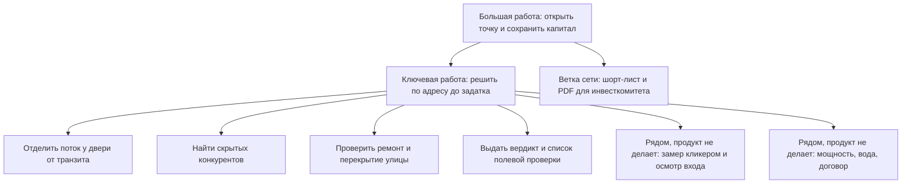

# ДЗ-4. Граф работ и карта сегментов

> Это же — материал промежуточной защиты.
> Пометка происхождения узлов — не формальность: это первое, что спросят на защите. Что здесь услышано, а что вы придумали сами?

**Обучающийся, группа:** Егор Швецов, AI-360-01

## Инвестиционная рекомендация

Первый рынок — предприниматель, который открывает одну точку кофе с собой и сам подписывает договор аренды. Продукт продаёт ему решение по адресу до задатка.

Рядом рассмотрены ещё три контура. У них другая работа или другое лицо, которое подписывает расход. Сеть пунктов выдачи — следующий рынок: бюджет компании и еженедельный поток адресов. Цветочная розница и франчайзи пекарни в первый релиз не входят.

Основание узлов: **[И]** — интервью в `interviews/` (все шесть проведены с моделями, живых респондентов нет), **[Д]** — допущение команды, в расшифровках этого нет.

## Граф работ по итогам интервью

Граф собран вокруг работы, за которую платит первый клиент: решить по одному адресу до задатка. Конвейер сети вынесен отдельной веткой.

| Уровень | Работа | Происхождение |
|---|---|---|
| Большая работа — ради чего | Открыть точку и сохранить 700 тыс. собственных средств и 500 тыс. кредита. Ошибка — люди на улице есть, покупателей нет | **[И]** `chatgpt/chatgpt_b2c.md` §1, §5; `deepseek/deepseek_b2c.md` §1; `alice_ai/alice_ai_b2c.md` |
| Ключевая работа — что продукт выполняет целиком | По адресу за несколько минут решить: ехать на просмотр и вносить задаток или снять объект с рассмотрения. На выходе вердикт «подходит / осторожно / не брать» и основание | **[И]** `chatgpt_b2c.md` §1, §4; `deepseek_b2c.md` §4; `alice_ai_b2c.md` |
| Смежные работы — того же уровня, продуктом не выполняются | Замерить поток у двери в разные часы. На одну точку уходит от 1,5 до 12 часов | **[И]** Alice: три выезда и 12 часов; DeepSeek: 1,5 часа и около 120 человек; ChatGPT: полдня на локацию |
| Смежные | Проверить электрическую мощность, воду, вентиляцию, вывеску и договор | **[И]** `chatgpt_b2c.md` §3, §5 |
| Смежные | Для сети: из пула 20–30 адресов собрать шорт-лист и PDF, который директор выпускает на комитет с первой подачи | **[И]** `alice_ai/alice_ai_b2b.md`, `deepseek/deepseek_b2b.md`, `chatgpt/chatgpt_b2b.md` |
| Микроработы — из чего состоит ключевая | Отделить людей у двери от тех, кто идёт к метро, на остановку или по другой стороне улицы | **[И]** `chatgpt_b2c.md` §5; `alice_ai_b2c.md`; `deepseek_b2c.md` §5 |
| Микроработы | Найти конкурентов вне карты: арка, пекарня с кофе, окно выдачи, точка во дворе | **[И]** `alice_ai_b2c.md`; `chatgpt_b2c.md` §2; `deepseek_b2c.md` §3 |
| Микроработы | Проверить ремонт тротуара и перекрытие улицы на ближайшие месяцы | **[И]** все три интервью B2C |
| Микроработы | Определить состав потока: офис, жители, студенты, туристы | **[И]** `chatgpt_b2c.md` §3; `alice_ai_b2c.md` |
| Микроработы | Вердикт с источником и список того, что клиент проверяет на объекте сам | **[И]** `chatgpt_b2c.md` §4. Тот же состав отчёта повторили три модели |

## Критическая цепочка

Цепочка первого клиента. У сети пунктов выдачи цепочка начинается иначе: на входе не одно объявление, а пул от брокера.

| Шаг | Что делает | Чем пользуется | Обрыв / переключение? |
|---|---|---|---|
| 1 | Находит объявление. Собственник требует задаток в тот же день | Авито, Циан, телефон | Триггер. Клиент выбирает между потерей объекта и невозвратным платежом. В интервью задаток 30 тыс. и 5 тыс. руб. **[И]** |
| 2 | Смотрит карту, фото и отзывы | Яндекс, 2ГИС, фото объявления | Обрыв. На карте вход с улицы, на месте вход во двор и глухая стена. Скрытых точек на карте нет. **[И]** `chatgpt_b2c.md` §2; `deepseek_b2c.md` §1 |
| 3 | Едет считать людей и обходит дворы | Кликер в телефоне, осмотр, разговор с продавцом соседней точки | Обрыв. 1,5–12 часов на адрес. Вечерний слот выпадает из-за найма. После нескольких объектов впечатления смешиваются. Кликер считает и транзитный поток. **[И]** |
| 4 | Звонит собственнику без цифр у двери, без портрета потока и без новостей о ремонте | Память | Обрыв. Решение принимается без фактов. **[И]** `deepseek_b2c.md` §3 |
| 5 | Готовит перевод задатка | Банковская карта | Переключение. Собственник ограничивает время. Остановка — память о кредите и о том, что задаток не возвращается. **[И]** `deepseek_b2c.md` §1; `chatgpt_b2c.md` §1 |
| 6 | Снимает объект или едет смотреть вход, щиток и договор | Полевой чек-лист | Продукт стоит на шагах 2–5. Осмотр объекта остаётся у клиента: пандус, ступени, деревья у витрины, конфликт с жильцами на карте не видны. **[И]** три интервью B2B; для кофе тот же предел в `chatgpt_b2c.md` §4–§5 |

## Карта сегментов

Сегмент — общая работа и общие критерии успеха. Формат точки важен там, где от него меняется критерий и право подписи.

Число торговых точек — размер рынка объектов. В расчёте ниже отдельно оценено число людей, которые принимают решение о помещении. Оценки числа людей помечены **[Д]**: в интервью и в открытых сводках этой цифры нет.

| Параметр | Сеть ПВЗ | Цветочная розница | Кофе to-go, один собственник | Франчайзи пекарни |
|---|---|---|---|---|
| Описание: работы и критерии успеха | Менеджер развития еженедельно сжимает пул 20–30 адресов до шорт-листа. Успех: плотность домохозяйств выше порога сети, расстояние до своей точки 400–600 м и больше, первый этаж, отдельный вход, пандус. У отказа есть порог и источник. Паспорт выходит на комитет в стандартном виде. **[И]** | Собственник одной точки до задатка оценивает, остановится ли покупатель у витрины. Успех **[Д]**: подход к витрине, жилые дома для повторной покупки, другие цветочные магазины в пешей доступности видны до звонка. Работа «решить до задатка» подтверждена на кофе **[И]**. Отраслевые критерии цветов — допущение | Собственник без отдела развития решает по одному адресу до задатка. Успех: поток у двери по часам отдельно от транзита, состав прохожих, скрытые конкуренты, ремонт улицы, вердикт и полевой список. Прогноз выручки до рубля в покупку не входит. **[И]** | Франчайзи ищет помещение и финансирует запуск. Адрес проходит стандарт сети: этаж, площадь, вход, пандус, каннибализация. Для франчайзи успех — экономика точки. Для франчайзора — сохранность соседних точек и прохождение комитета. Стандарт сети **[И]**, позиция франчайзи **[Д]** |
| Кто принимает решение | Директор по развитию и инвестиционный комитет. Менеджер готовит материалы. **[И]** | Собственник магазина. Он выбирает адрес и он оплачивает отчёт. **[Д]** | Собственник. Кредит выдаёт банк, адрес выбирает собственник. **[И]** | Два лица. Франчайзи решает вопрос своих денег. Франчайзор утверждает адрес. В интервью представлена сторона франчайзора. **[И]** / **[Д]** |
| Размер — сколько таких людей | 226,4 тыс. ПВЗ в России на 01.01.2026, в Казани 2 374 (Яндекс Карты, «Коммерсант»). Решение об экспансии принимают единицы сетей и их региональные команды. Порядок — сотни человек по стране **[Д]** | Около 39 тыс. магазинов на март 2026, за год −2,7% (Яндекс Карты, «Ведомости»). Около 90% точек несетевые. Одновременно помещение выбирают тысячи человек в год, не все 39 тыс. **[Д]** | Классических кофеен около 25,7 тыс. (Платформа ОФД, 2025). Сетевых кофеен и кафе-кондитерских 14 128 на июль 2025 (РБК Исследования рынков). Сегмент — человек, который открывает первую точку to-go на собственные и кредитные деньги. Порядок — тысячи таких решений в год по стране **[Д]** | Тот же контур 14 тыс. сетевых точек и сотни сетей (РБК, июль 2025). Франчайзи на запуске — тысячи. Сотрудники франчайзора, которые утверждают адрес, — сотни **[Д]** |
| Частота работы | Постоянная. Пул каждую неделю, план 3–5 открытий в месяц, 1,5–2 дня на пул. **[И]** | Разовая на период поиска помещения, затем работа заканчивается. **[Д]** | Несколько адресов за недели поиска, затем стоп. Пять объектов за неделю уже смешиваются. **[И]** `chatgpt_b2c.md` §2; `deepseek_b2c.md` §2 | У франчайзи один запуск. У франчайзора недельный конвейер, как у сети ПВЗ. **[Д]** / **[И]** |
| Бюджет работы — сколько уже тратят | До двух рабочих дней менеджера на пул. 70–80% времени — нормализация адресов и сбор данных из разных источников. Оплата из бюджета развития сети, форма — подписка. Сумма контракта в интервью не названа. Расчёт 50 000 ₽ в `chatgpt_b2b.md` — модельное допущение | Отдельного исследовательского бюджета нет. Готовность платить за отчёт по цветочной точке не измерена. **[Д]** | Отдельного бюджета нет. На один адрес уходит от полудня до двух дней плюс поездки. Под риском задаток 5–30 тыс. руб. Вилка 500–1 500 ₽ за отчёт есть во всех трёх интервью B2C; цена была задана в вопросе, к факту платежа её не приравниваем | Франчайзи финансирует запуск точки. Бюджет на программное обеспечение в интервью находится у франчайзора. **[И]** |
| Достижимость — можем ли дотянуться | Ограниченная. Контакт с директором развития и комитетом на этой стадии не установлен | Прямая. Собственник одной точки доступен через объявления об аренде. Интервью с цветочным ритейлом ещё не проведены | Прямая. Клиент уже находится на Авито и Циан в Казани. Живое интервью впереди, роль и работа описаны тремя независимыми сессиями | Франчайзи доступен так же, как собственник одной точки. Сделка закрывается после подписи франчайзора. Этого контакта нет |
| Возможность создать ценность | Высокая для операционной работы: автоматический отсев 70–80% неликвидного пула и стандартный PDF. Эффект для комитета описан в интервью и ждёт проверки на исторических адресах | Условная. Отчёт с критериями кофейни для цветочной точки ценности не создаёт: кофе зависит от утреннего потока у двери, цветы — от остановки у витрины и повторной покупки жителей. Критерии нужно снять отдельно | Высокая. Отчёт закрывает разрыв между картой и кликером до звонка собственнику: вердикт, поток у двери с пометкой точности, конкуренты, ремонт, полевой список. Осмотр объекта остаётся за клиентом | Средняя. Франчайзи получает ту же пользу, что собственник кофейни. Покупка останавливается на стандарте франчайзора |
| Конкуренция | Excel, Яндекс, 2ГИС, ручная сверка с действующими точками, разрозненные реестры ограничений. **[И]** | Яндекс и 2ГИС. **[Д]** | Те же карты, кликер и разговор с персоналом соседней точки. **[И]** | Карты и регламент франчайзора. Выбор софта на стороне франчайзора. **[Д]** |

## Обоснование выбора целевого сегмента

Целевой сегмент — собственник одной точки кофе с собой. Он сам выбирает адрес и сам платит.

1. **Как мы создаём для них ценность?** Между объявлением и задатком клиент тратит на один адрес от 1,5 до 12 часов и на выходе не отделяет транзит от покупателя, не видит точку во дворе и не знает о перекрытии улицы. Продукт выполняет эту работу до звонка. Состав отчёта совпал в трёх интервью B2C. Замер у двери и проверка инженерии остаются у клиента.
2. **Как мы на них зарабатываем?** Оплата с личной карты за отчёт по одному адресу. Рабочая гипотеза цены — 500–1 500 ₽. Она взята из вопроса интервью и подлежит проверке живой оплатой. Экономика сходится на отчёте из открытых слоёв: конкуренты, новости о работах, чек-лист, вердикт. Покупной пешеходный трафик в этот чек не входит и в первой версии не продаётся как точная цифра.
3. **Как создаём спрос и растём внутри сегмента?** Канал — Авито и Циан, Казань, момент требования задатка. Повторные продажи одному клиенту ограничены: после открытия точки работа заканчивается. Рост даёт следующий собственник в той же работе.

**От чего отказались и почему:**

- **Сеть ПВЗ.** Частота и бюджет выше: компания платит за еженедельный отсев пула. Подпись стоит у директора и инвестиционного комитета. Контакт с этим лицом не установлен, цена подписки не подтверждена. Сегмент стоит вторым, после пилота на исторических адресах и разговора с тем, кто выпускает паспорт на комитет.
- **Цветочная розница.** Право подписи такое же, как у кофе: собственник одной точки. Критерий успеха другой, и он пока допущение. Запуск на критериях кофейни размоет продукт. Сегмент открывается отдельным исследованием критериев, не копией первого отчёта.
- **Франчайзи пекарни.** В сделке два лица. Франчайзи оплачивает запуск, франчайзор утверждает адрес по радиусу, этажу и пандусу. Интервью закрывают сторону франчайзора. Цикл с двумя подписями для первой версии длинный.

---

### Как будет оцениваться

| | |
|---|---|
| **A** | Граф построен на материале интервью: узлы прослеживаются до расшифровок. Различены уровни работ. В цепочке отмечены обрывы и переключения. Сегменты выделены по работам и критериям успеха, выбор обоснован через возможность создать ценность и заработать |
| **B** | Граф и цепочка построены корректно, но связь с интервью прослеживается частично; обоснование выбора опирается в основном на размер сегмента |
| **C** | Граф отражает функции продукта, а не работы пользователя; сегменты выделены преимущественно по демографии, отрасли или размеру компании |
| **D** | Граф работ отсутствует либо сегментация подменена описанием целевой аудитории |

Смена замысла по итогам интервью оценку не снижает. Отсутствие следов исследования — снижает.
