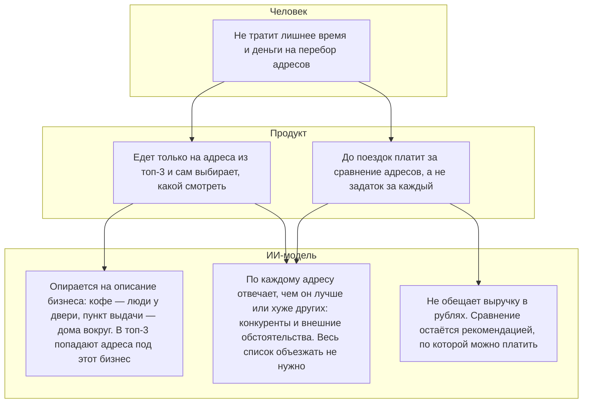

# ДЗ-6. Экономика, метрики, допущения

> Около 2 часов. Экономика без стоимости эксплуатации модели не принимается.
> Приблизительные цифры допустимы. Отсутствие целой статьи затрат — нет.

**Обучающийся, группа:** Егор Швецов, AI-360-01

Человек описывает бизнес и платит 1 000 ₽ за один подбор лучшего адреса. За месяц 25 таких подборов. Третий столбец — те же 25, умноженные на 10.

| | 1 подбор | 25 подборов в месяц | 250 подборов в месяц |
|---|---:|---:|---:|
| **Доход** | **1 000 ₽** | **25 000 ₽** | **250 000 ₽** |
| Обучение | 0 ₽ | 0 ₽ | 0 ₽ |
| Эксплуатация модели | 6 ₽ | 150 ₽ | 1 500 ₽ |
| Реклама | 480 ₽ | 12 000 ₽ | 120 000 ₽ |
| **Расходы** | **486 ₽** | **12 150 ₽** | **121 500 ₽** |
| **Прибыль** | **514 ₽** | **12 850 ₽** | **128 500 ₽** |

## Дерево метрик

Три уровня сверху вниз: человек, продукт, ИИ-модель.

Боль — лишние поездки и задаток на адреса, которые всё равно отсеются. Через продукт человек платит за сравнение до поездки и едет только на адреса из топ-3. Модель для этого опирается на описание бизнеса и по каждому адресу пишет, чем он лучше или хуже других. Обещания выручки в рублях в ответе нет: за такую цифру он не платит, так сказано в `chatgpt/chatgpt_b2c.md`, раздел 4.

## Рискованные допущения

Сначала то, что ломает деньги и пока почти не проверено.

| № | Допущение | Что будет, если неверно | Уверенность (высокая / средняя / низкая) |
|---|---|---|---|
| 1 | Подбор лучшего адреса покупают примерно за 1 000 ₽, и платит 1 человек из 20 кликов | При такой цене после модели и рекламы остаётся 514 ₽. При цене 500 ₽ после модели остаётся 494 ₽, реклама 480 ₽ почти всё съедает. Если платит 1 из 40, среднее привлечение уже 960 ₽: при цене 1 000 ₽ на руках около 30 ₽, при цене 500 ₽ реклама дороже подбора | Низкая. В интервью цену называли за проверку одного адреса, и её подсказали в вопросе. Долю кликов, которые становятся оплатой, ещё не мерили |
| 2 | По описанию бизнеса модель верно выбирает критерий, а Геокодер находит конкурентов рядом с лучшим адресом | Если кофейне подсовывают критерий пункта выдачи или в списке нет точки во дворе, первый адрес плохой. Человек это видит на месте и второй раз не платит | Низкая. Разница критериев записана в ДЗ-1. Дворы, которых нет на карте, описаны в `chatgpt_b2c.md`, раздел 2, и в `deepseek_b2c.md`, раздел 1 |
| 3 | Лучший вариант есть среди примерно 10 объявлений, которые смотрим за один подбор | Если нужного помещения в этой десятке нет, человек не получает то, за что заплатил. Повторный подбор в выручку месяца не заложен | Средняя. В интервью человек смотрит несколько адресов сам. Что десятка объявлений покрывает его поиск, мы не проверяли |

## План проверки главного допущения

Главное допущение — первое: живые деньги, около 1 000 ₽, за выбор лучшего адреса, до того как человек увидел весь список. Для проверки сервис собирать не нужно.

| | |
|---|---|
| Допущение | Человек, который открывает кофе с собой, платит около 1 000 ₽ за подбор лучшего адреса по описанию своего бизнеса |
| Способ проверки | Просим коротко описать точку: кофе с собой, Казань, свои деньги. Берём 10 живых объявлений аренды. Конкурентов и внешние обстоятельства смотрим руками. В ответ называем один лучший адрес и почему он первый. Остальные девять отдаём после предоплаты 1 000 ₽ |
| Срок | 7 дней |
| Признак подтверждения | Хотя бы 3 человека из 10, кто сейчас ищет помещение, платят до полного списка |
| Признак опровержения | Не платит никто. Либо просят список бесплатно, либо называют цену и не переводят деньги |

---

### Как будет оцениваться

| | |
|---|---|
| **A** | В расчёте учтены стоимости данных, разметки, обучения и эксплуатации; показано, что происходит при росте нагрузки. Дерево метрик причинно связано с целью, метрики продукта и модели различены. Допущения ранжированы, для верхнего назван самый дешёвый способ проверки |
| **B** | Расчёт полон, но чувствительность к нагрузке не показана; ранжирование допущений сделано без явного основания |
| **C** | Экономика посчитана без затрат на модель; дерево метрик — список показателей без связи с целью |
| **D** | Расчёта нет либо допущения не выделены |
